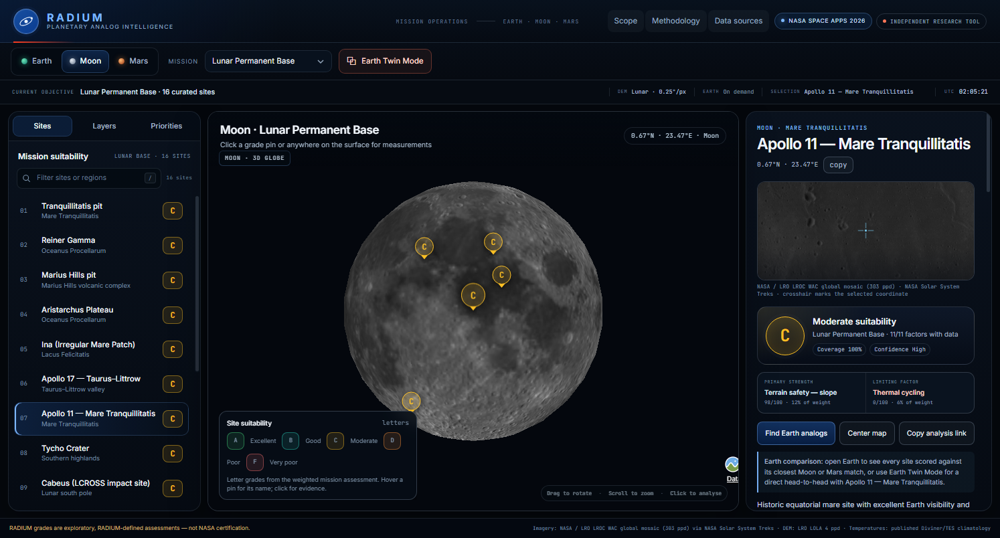

# RADIUM

**Planetary analog intelligence** — an independent mission-science console for Moon, Mars and Earth analog analysis.

RADIUM asks two questions and keeps them strictly apart. First, *where on the Moon or Mars should a mission go, and why?* Second, *what place on Earth is the closest measurable stand-in for that site?* You explore the Moon and Mars on interactive 3D globes, score real sites against configurable mission priorities, get letter grades you can open up factor by factor, and switch on **Earth Twin Mode** to rank terrestrial environments by measured similarity to the planetary site you are looking at.

It is built as a working scientific application, not a mockup. Elevation, slope and roughness are computed live from bundled NASA DEMs; Earth climate comes from live NASA POWER climatology (ERA5 fallback); imagery is streamed from NASA's Solar System Treks and NASA GIBS. Where data does not exist, RADIUM says so, reduces coverage and confidence, and refuses to invent a value.



<sub>Desktop mission console. The responsive mobile layout is captured in [docs/radium-mobile.png](docs/radium-mobile.png).</sub>

> RADIUM is an independent research tool. It is not an official NASA product, and its grades are not NASA certification, landing approval, or a substitute for mission-specific engineering analysis.

---

## One of three prototypes in the Rice Cooker submission

This repository is **prototype one of three** built by **Rice Cooker** for the **NASA Space Apps Challenge, Princeton 2026**. The team did not enter three separate projects. The three prototypes were built in parallel, each exploring a different way to make planetary science usable, and were then **merged into a single submission**: one entry, one narrative, three complementary working prototypes presented together rather than as competitors.

RADIUM is the analysis-and-mapping prototype. Its job in the merged submission is the part that the other two do not attempt:

- **Planetary site assessment** — Moon and Mars sites scored against real mission profiles, with explainable grades and explicit data gaps.
- **Terrestrial analog discovery** — Earth Twin Mode, which measures Earth sites live and ranks them against a chosen planetary site, or runs the same match in reverse for any Earth coordinate.
- **The science console itself** — the globes, DEM sampling, ranking lists, comparison views and provenance registry that present all of it on screen.

Each prototype kept its own codebase and its own README so the work stays inspectable, reproducible and individually runnable; the merged submission presents them as one body of work. RADIUM is deliberately a **static, zero-dependency, no-build-step application**, which is what made it possible to fold into the combined submission without a shared toolchain or a deployment rewrite — it can be served from a single command, hosted on any static host, and linked or embedded alongside the other two prototypes.

RADIUM is independent work. NASA Space Apps is a challenge programme, not an endorsement, and nothing here should be read as NASA certification of a site.

---

## Quick start

```bash
npm start          # zero-dependency static server on http://localhost:8080
# or
node server.mjs 8080
```

No install or build step is required. An internet connection is needed for NASA imagery tiles and Earth measurements (NASA POWER, with ERA5/Open-Meteo fallback). CesiumJS, MapLibre GL and fonts are loaded from public CDNs.

```bash
npm test           # 31 unit and catalog-integrity tests
npm run data       # re-download and rebuild the bundled DEMs from NASA PDS
```

Requires Node 20+ (developed on Node 24). The app itself is plain ES modules.

---

## Features

| Area | Status |
| --- | --- |
| Mission operations console with live DEM/cache/selection telemetry and UTC | Working |
| Instant candidate search across sites, regions, countries and material classes | Working |
| Shareable analysis links restoring body, mission, site and Twin pair | Working |
| Decision-support cards for primary strength and limiting factor | Working |
| Responsive analysis drawer with keyboard and screen-reader support | Working |
| 3D Moon globe with LRO LROC WAC imagery | Working (CesiumJS) |
| 3D Mars globe with Viking MDIM21 imagery | Working (CesiumJS) |
| 2D Earth map with NASA GIBS Blue Marble, ASTER topography, MODIS albedo/LST and MERRA-2 AOD layers | Working (MapLibre) |
| Real LOLA/MOLA DEM point sampling (0.25°/px, fixed 10 km terrain baseline) | Working — elevation, slope, roughness |
| DEM-derived global elevation/slope/roughness layers with legends | Working |
| 16 curated lunar sites, 15 Mars sites | Working |
| Mission profiles: lunar base, Mars robotic landing, Mars human exploration | Working |
| Adjustable priorities with live re-ranking and explanation | Working |
| Explainable A–F suitability grades with coverage/confidence and constraints | Working |
| Grade-coloured factor bars for every mission factor, plus luminosity, thermal cycling and surface trafficability | Working |
| Earth Twin Mode: rank the top five Earth analogs for a selected Moon/Mars site, or compare any clicked Earth coordinate factor by factor | Working |
| Statistical shortlist of less-studied Earth candidates for the selected planetary site | Working (curated pool only) |
| 0–100 Earth similarity estimates on every pin, candidate row and comparison hero | Working |
| Top-five-only Earth-analog matrix in Twin Mode, plus top-five Moon/Mars comparison for any Earth site | Working |
| Earth dossier: overall best-planet match, eight-factor analog profile, brightness/albedo factors, explicit data gaps | Working |
| Experimental score for any clicked Earth coordinate from live climate, multi-scale terrain, SoilGrids and Smithsonian volcano context | Working |
| Side-by-side comparison, strong/weak matches, applications, physical mismatches | Working |
| Dataset registry with provenance, resolution, licensing and limitations | Working |
| Context imagery at the selected coordinate | Working (NASA tiles drawn client-side) |

### What the three views do

- **Moon / Mars** — a 3D globe, a ranked candidate list and a per-site decision brief. Thirteen mission factors covering ice, solar energy, luminosity, thermal cycling, trafficability, slope, roughness, thermal conditions, communications, dust, landing altitude, geology and exploration value feed the mission profile you pick. Sliders re-weight priorities and the ranking, shares and explanations update live.
- **Earth** — a 2D map where each curated terrestrial site is measured live and scored against its single best Moon or Mars match, so a pin answers "what is this place the best analog of?" rather than just "where is it?"
- **Earth Twin Mode** — both maps side by side. A planetary site on the left, the top five measured Earth analogs on the right, and a factor-by-factor comparison with strong matches, weak matches, real-world applications and physical mismatches. Any clicked Earth coordinate can be compared the same way, including an experimental score built from live climatology, multi-scale terrain, topsoil texture and the nearest Holocene volcano.

### Console accessibility and resilience

- A persistent mission strip reports DEM readiness, Earth-profile cache state, current selection and UTC without stealing focus.
- Candidate rankings filter instantly by site, region, country or material class; `/` focuses search and `Escape` clears it.
- Analysis links restore the selected body, mission and site, including curated Earth analogs and Twin pairs. Arbitrary clicked coordinates are encoded by latitude/longitude.
- At medium widths the inspector becomes an explicit drawer with a scrim; at narrow widths it stacks below the map. Desktop remains a three-pane console.
- Dialogs trap focus, restore focus on close, and support `Escape`. A skip link, visible focus rings and reduced-motion styles are included.
- Data failures remain visible: unavailable imagery appears on the map, Earth climate failures reduce similarity coverage, and no placeholder observation is invented.

### Explicitly not implemented

- Global per-pixel planetary temperature or ice rasters (RADIUM uses labelled regional values/published models instead).
- Certified landing-hazard analysis at metre scale. The 0.25° DEM cannot resolve it, and the UI says so.
- Gravity, atmosphere, radiation or magnetic-field simulation. These are listed as **not comparable**, never scored.
- Autonomous global discovery of arbitrary new analog sites. The candidate pool is curated and extensible; arbitrary Earth points receive an experimental score from live climate and terrain, but that is not the same as a validated field analog.
- A multi-user database backend. The data layer is static + live public APIs.

---

## Scientific design in one page

1. **Site suitability** — weighted multicriteria model over mission-specific factors:
   `S = Σ(wᵢ·sᵢ) / Σwᵢ`, with weights normalised over available factors. Hard screens can cap a grade at F. Coverage and confidence are reported; a grade is withheld below 50% data coverage.
2. **Earth analog similarity** — separate dimension-by-dimension comparison:
   `A = Σ(vᵢ·dᵢ) / Σvᵢ`, using documented scales for thermal, terrain and luminosity dimensions and fixed affinity matrices for material/volatile classes. Gravity, pressure, radiation and dust physics are excluded and displayed as mismatches.
   The inverse direction matches each Earth candidate against all 31 curated Moon/Mars sites, selects its best overall analog match, and groups the same comparable dimensions into the eight-factor profile. Dust, biology and subsurface factors have no comparable datasets and remain explicitly unassessed.

Grades: A ≥ 80, B ≥ 65, C ≥ 50, D ≥ 35, F < 35. These are RADIUM-defined exploratory assessments, **not NASA certification**.

Every measurement is tagged as **observed**, **derived**, **published model**, **modelled estimate**, **inferred** or **assessment**, with a note and uncertainty where applicable.

Full derivations, anchors, weights and validation: [`docs/METHODOLOGY.md`](docs/METHODOLOGY.md). Provenance and licensing: [`docs/DATA_SOURCES.md`](docs/DATA_SOURCES.md).

---

## Architecture

```
index.html                 App shell, CDN libraries
css/radium.css             Design system and responsive layout
server.mjs                 Zero-dependency static server

js/app.js                  Controller: state, selection, twin mode, rendering
js/ui/modals.js            Methodology, sources and scope dialogs

js/data/
  constants.js             Body radii, gravity, datums, caveat
  datasets.js              Dataset registry (provenance, licensing, limits)
  moon-sites.js            16 curated lunar sites with evidence classes
  mars-sites.js            15 curated Mars sites with evidence classes
  analogs.js               34 terrestrial candidate sites (no hardcoded climate)
  earth-climate.js         Live NASA POWER/ERA5 + Copernicus DEM sampling and indices
  earth-context.js         SoilGrids and Smithsonian volcano context

js/science/
  grade.js                 A–F bands, piecewise interpolation, formatting
  suitability.js           Mission profiles, priorities, missing-data policy
  similarity.js            Earth Twin dimensions, affinities, coverage, confidence
  solar.js                 Solar geometry, Mars pressure approximation
  terrain.js               DEM bilinear sampling, Horn slope, roughness

js/maps/
  globe.js                 Cesium Moon/Mars globes and grade markers
  earth.js                 MapLibre Earth map and GIBS overlays
  dem-layer.js             DEM-derived rasters + legends
  thumb.js                 Real context-imagery thumbnails at coordinates

data/
  moon_lola_4ppd.bin       1440×720 int16, little-endian (LOLA LDEM 4 ppd)
  mars_mola_4ppd.bin       1440×720 int16, little-endian (MOLA MEGDR 4 ppd)
  dem-meta.json            Grid metadata, source checksums, percentiles

tools/prepare-data.mjs     Reproducible PDS ingestion
tests/                     31 unit + catalog-integrity tests
docs/                      Methodology and data-source documentation
```

---

## Data at a glance

| Use | Product | Access |
| --- | --- | --- |
| Lunar elevation/slope/roughness | LRO LOLA LDEM 4 ppd (PDS) | Bundled binary (2 MB), reproducible |
| Mars elevation/slope/roughness | MGS MOLA MEGDR 4 ppd (PDS) | Bundled binary (2 MB), reproducible |
| Moon imagery | LRO LROC WAC 303 ppd mosaic | Live WMTS, NASA Solar System Treks |
| Mars imagery | MGS Viking MDIM21 color mosaic 232 m | Live WMTS, NASA Solar System Treks |
| Earth basemap | NASA Blue Marble / shaded relief | Live WMTS, NASA GIBS |
| Earth temperature overlay | MODIS Terra LST 8-day day | Live WMTS, NASA GIBS |
| Earth aerosol overlay | MERRA-2 monthly AOD at 550 nm | Live WMTS, NASA GIBS |
| Earth climate | NASA POWER 25-year climatology (2001–2025) | Live POWER API; ERA5 fallback |
| Earth terrain | Copernicus DEM GLO-90 | Live Open-Meteo elevation API; Open-Elevation/SRTM and AWS Terrarium fallbacks |
| Earth topsoil context | SoilGrids 2.0 | Live ISRIC API; context only, not scored |
| Earth volcanic context | Smithsonian GVP Holocene volcanoes | Bundled trimmed snapshot; nearest-center context only |
| High-resolution reference | TerraClimate, GLDAS, ASTER GED, ALOS AW3D30, Planetary Computer | Catalogue/provenance records; not point-queried in this build |
| Planetary temperature/illumination/ice | Diviner, LAMP/Mini-RF, LCROSS, CRISM, Odyssey, SHARAD, TES | Cited regional values, never fabricated point data |

Live services can be unavailable. RADIUM degrades explicitly: imagery errors appear on the map, Earth climate failures produce "Data unavailable" and drop similarity dimensions, and the app never substitutes placeholder science.

---

## Reproducing the DEMs

```bash
npm run data            # downloads from PDS, converts endianness, writes checksums
```

- Moon: `ldem_4.img` (`LSB_INTEGER`, height = DN × 0.5 m, reference radius 1,737.4 km).
- Mars: `megt90n000cb.img` (`MSB_INTEGER`, metres relative to the IAU 2000 areoid, converted to little-endian).
- Result: `data/*.bin` + `data/dem-meta.json` (min/max/mean, 2nd/98th percentiles, SHA-256, source URL, preparation timestamp).

No values are altered other than byte order. Percentiles are used only for colour-ramp scaling.

---

## Tests and verification

`npm test` covers:

- Grade-band boundaries and A–F monotonicity.
- Mission weights sum to 1; missing data is dropped and renormalised; coverage threshold withholds a grade.
- Hard constraints cap the grade at F.
- Priority multipliers change effective weights while staying normalised.
- Similarity bounded 0–1, symmetry of affinity matrices, identical values → 1.0, missing dimensions renormalised, incomparable physics listed.
- DEM bilinear sampling, Horn slope on synthetic grids, roughness behaviour.
- NASA POWER and ERA5 summariser arithmetic, aridity and comparable solar fraction.
- SoilGrids texture conversion and nearest-volcano context.
- Earth-to-planet ranking symmetry and eight-factor Earth grading.
- Catalog integrity: unique ids, valid coordinates/groups, provenance references, polar illumination overrides, no hardcoded Earth climate.

Run `node server.mjs` and open the app to exercise live layers. Verification notes for this build are in [`docs/METHODOLOGY.md`](docs/METHODOLOGY.md#7-validation).

---

## Operational readiness

This build is presented as a research console, not as a certified operational system.

| Area | Posture in this build |
| --- | --- |
| Scientific claims | Every grade is labelled RADIUM-defined; missing data is explicit; incomparable physics are excluded. |
| Provenance | Dataset registry records mission, resolution, access, licensing, processing and limitations. |
| Failure behavior | Live-service failures surface in-map or in-context and reduce coverage instead of creating estimates. |
| Reproducibility | LOLA/MOLA DEMs are bundled with hashes and a repeatable ingestion tool; scoring engines are unit-tested. |
| Shareability | Analysis state is encoded in the URL and restores on a fresh load. |
| Accessibility | Keyboard navigation, focus management, search shortcut, live status regions and reduced-motion support. |
| Responsive use | Three-pane desktop console, explicit medium-width drawer, stacked mobile analysis. |
| Deployment | Static, dependency-free server; no build step; can be hosted on any static host. |
| Independence | No NASA endorsement is claimed or implied; the interface states that RADIUM is independent. |

Known gaps are listed in [Explicitly not implemented](#explicitly-not-implemented) and in the in-app Scope panel. Certified landing-hazard analysis, global per-pixel planetary temperature/ice rasters, and radiation/atmosphere simulation are deliberately out of scope.

---

## Attribution

- NASA / LRO LOLA, LROC, Diviner; NASA / MGS MOLA, TES; NASA / MRO CRISM, SHARAD, HiRISE/CTX; NASA LCROSS; NASA Odyssey; NASA GSFC and USGS Astrogeology. NASA public-domain data; mission attribution retained.
- NASA Solar System Treks for planetary WMTS tiles.
- NASA GIBS / EOSDIS for Earth imagery and environmental layers.
- NASA POWER (NASA Langley Research Center; MERRA-2/POWER) for Earth climatology.
- ERA5 / Copernicus Climate Change Service (fallback) and Copernicus DEM, accessed through Open-Meteo (subject to their terms).
- ISRIC SoilGrids for topsoil context; Smithsonian Global Volcanism Program for volcanic context.
- Esri World Imagery / reference labels where selected (attribution on map).
- CesiumJS and MapLibre GL JS (Apache-2.0 / BSD).

**Rice Cooker** — NASA Space Apps Challenge, Princeton 2026. RADIUM is one of three prototypes merged into the team's single submission. It is an independent project, not an official NASA product. Site grades are exploratory scientific assessments, not mission approval.
